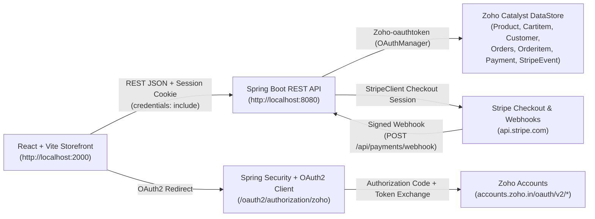
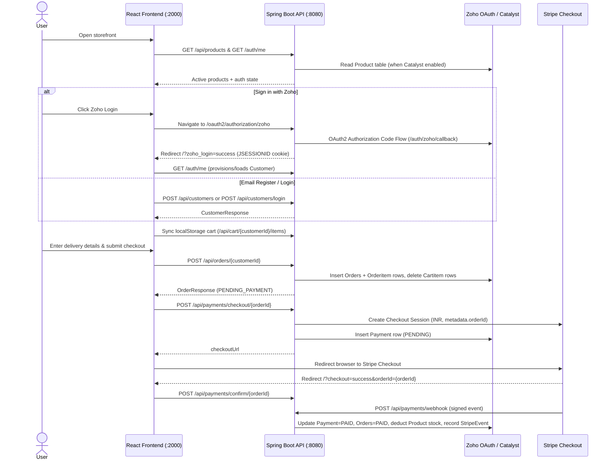

# Form & Field — Full-Stack E-commerce Storefront

A full-stack E-commerce web application built with **Spring Boot 4.1.2 (Java 25)**, **React 19 + Vite 6**, **Zoho OAuth2**, **Zoho Catalyst DataStore**, and **Stripe Checkout**.

---

## Table of Contents

1. [Project Overview](#1-project-overview)
2. [Features and Functionality](#2-features-and-functionality)
3. [Technology Stack](#3-technology-stack)
4. [Project Architecture](#4-project-architecture)
5. [Complete Project Directory Structure](#5-complete-project-directory-structure)
6. [Prerequisites and Software Versions](#6-prerequisites-and-software-versions)
7. [Installation Instructions](#7-installation-instructions)
8. [Backend Configuration and Startup](#8-backend-configuration-and-startup)
9. [Frontend Configuration and Startup](#9-frontend-configuration-and-startup)
10. [Environment Variable Configuration](#10-environment-variable-configuration)
11. [Zoho OAuth Setup](#11-zoho-oauth-setup)
12. [Zoho Catalyst Setup](#12-zoho-catalyst-setup)
13. [Stripe Integration and Test-Mode Setup](#13-stripe-integration-and-test-mode-setup)
14. [API Endpoint Documentation](#14-api-endpoint-documentation)
15. [Application Execution Workflow](#15-application-execution-workflow)
16. [Testing Instructions](#16-testing-instructions)
17. [Troubleshooting](#17-troubleshooting)
18. [Security Considerations](#18-security-considerations)

---

## 1. Project Overview

**Form & Field** is an end-to-end storefront combining a RESTful Spring Boot backend API and a single-page React storefront (`frontend/`). Customers can browse products, filter by category or search term, manage a shopping bag persisted in browser `localStorage` and synchronized with Zoho Catalyst DataStore when signed in, authenticate via email registration/login or **Zoho Accounts OAuth2 / OIDC**, place orders, and complete payments in **INR** through **Stripe Checkout** with webhook signature verification and inventory deduction.

---

## 2. Features and Functionality

- **Product Catalogue (`/api/products`)**
  - Create, list active products, retrieve by ID, update, and soft-delete (`active = false`) products.
  - Supports Zoho Catalyst `Product` table persistence when `app.catalyst.enabled=true` (`${APP_CATALYST_ENABLED:true}` in `backend/src/main/resources/application.properties`), or an in-memory `ConcurrentHashMap` pre-seeded with 4 sample electronics products when `app.catalyst.enabled=false`.
- **Customer Accounts & Authentication (`/api/customers`, `/auth/**`)**
  - Customer registration with validation (`customerName`: letters, spaces, and basic punctuation without digits; `email`: regex-validated and unique; `phone`: 10 digits; `address`: required).
  - Email-based customer lookup login (`POST /api/customers/login`) and profile update/deletion.
  - **Zoho OAuth2 / OIDC Sign-In** via Spring Security (`oauth2Login`), custom redirection endpoint `/auth/zoho/callback`, in-memory `ZohoUserToken` caching and refresh-token renewal (`ZohoTokenService`), and automatic customer provisioning (`CustomerService.findOrCreateForZohoUser`).
- **Shopping Cart (`/api/cart`)**
  - Add, update quantity, retrieve, and remove cart items per `customerId` with stock availability checks and automatic subtotal calculation (`BigDecimal`).
  - Dual storage mode: Zoho Catalyst `Cartitem` table (`app.catalyst.enabled=true`) or in-memory map (`app.catalyst.enabled=false`).
  - Frontend persists guest carts in browser `localStorage` and synchronizes them to the backend upon sign-in or checkout.
- **Order Management (`/api/orders`)**
  - Creates orders from the customer's server-side cart (`PENDING_PAYMENT`), inserts rows into Catalyst `Orders` and `Orderitem` tables with compensating cleanup (`deleteOrderAndItems`) if order-item insertion fails, and clears the cart.
  - Supports order lookup by order ID or customer ID, cancellation of `PENDING_PAYMENT` orders (`CANCELLED`), and synchronized order fulfillment (`PAID`) with stock deduction.
- **Stripe Checkout & Webhooks (`/api/payments`)**
  - Creates Stripe Checkout Sessions (`mode=payment`, currency `inr`, amounts converted to paise) and inserts `Payment` records in Catalyst.
  - Handles signed Stripe webhooks (`checkout.session.completed`, `checkout.session.async_payment_succeeded`, `checkout.session.async_payment_failed`) with signature verification (`Webhook.constructEvent`) and idempotency via the Catalyst `StripeEvent` table.
  - Exposes `POST`/`GET /api/payments/confirm/{orderId}`, invoked by the frontend on the Stripe success redirect to mark payment `PAID` and fulfill the order.
- **Centralized Error Handling**
  - `GlobalExceptionHandler` (`@RestControllerAdvice`) returns structured `ApiErrorResponse` JSON payloads (`status`, `error`, `message`, `path`, `details`) for validation failures (`400`), missing resources (`404`), conflicts (`409`), bad arguments (`400`), and unhandled errors (`500`).

---

## 3. Technology Stack

| Layer | Technology | Version |
| --- | --- | --- |
| **Backend Language** | Java | `25` (`backend/pom.xml`) |
| **Backend Framework** | Spring Boot (`spring-boot-starter-parent`) | `4.1.2` |
| **Web & Validation** | `spring-boot-starter-webmvc`, `spring-boot-starter-validation` | Managed by Boot `4.1.2` |
| **Security & OAuth2** | `spring-boot-starter-security`, `spring-boot-starter-oauth2-client` | Managed by Boot `4.1.2` |
| **Payments SDK** | `com.stripe:stripe-java` | `34.1.0` |
| **Utilities** | Lombok, Spring Boot DevTools, Jackson (`tools.jackson.databind`) | Managed by Boot `4.1.2` |
| **Build Tool** | Maven Wrapper (`./mvnw` / `mvnw.cmd`) | Apache Maven `3.10.0` |
| **Frontend Framework** | React & React DOM | `^19.1.0` |
| **Frontend Bundler** | Vite + `@vitejs/plugin-react` | `^6.3.5` / `^4.7.0` |
| **Backend Data Store** | Zoho Catalyst BaaS REST API (`/baas/v1/project/{projectId}/table/{table}/row`) | REST (`RestClient`) |
| **Testing** | JUnit 5, Mockito, Spring MockMvc, `spring-boot-starter-test`, `spring-boot-starter-security-test`, `spring-boot-starter-security-oauth2-client-test`, `spring-boot-starter-webflux-test` | Managed by Boot `4.1.2` |

---

## 4. Project Architecture



### Key Architectural Details

- **HTTP Client:** Backend integrations with Zoho Accounts and Zoho Catalyst use Spring's synchronous `RestClient` (`CatalystClient`, `OAuthManager`, `ZohoTokenService`), without JPA/SQL repositories.
- **Session & CORS:** `SecurityConfig` configures `CorsConfigurationSource` (`allowCredentials(true)`) allowing `APP_CORS_ALLOWED_ORIGIN`, `app.frontend-url`, and `http://localhost:2000`, HTTP-only session cookies (`SameSite=lax`), and OAuth2 login/logout handlers. `CorsConfig` also registers `WebMvcConfigurer` CORS mappings on `/**`.
- **Catalyst OAuth Token Management:** `OAuthManager` exchanges `zoho.catalyst.refresh-token` at `https://accounts.zoho.in/oauth/v2/token` and caches the access token in memory with a 60-second expiry buffer.
- **Zoho User OAuth Token Store:** `ZohoTokenService` caches per-user `ZohoUserToken` entries in an in-memory `ConcurrentHashMap` keyed by principal name and email, refreshing expired tokens against `${zoho.accounts.base-url}/oauth/v2/token`.

---

## 5. Complete Project Directory Structure

```text
E-commerce/
├── .gitattributes
├── .gitignore                            # Ignores .env, .env.*, zc-auth.json, target/, .idea, .vscode/, etc.
├── .mcp.json
├── README.md                             # Root project documentation
├── package-lock.json
├── backend/
│   ├── .env.example                      # Backend environment variable template (tracked)
│   ├── .mvn/                             # Maven Wrapper support files
│   ├── HELP.md                           # Local helper notes (gitignored)
│   ├── mvnw / mvnw.cmd                   # Maven Wrapper scripts
│   ├── pom.xml                           # Maven project & dependency configuration
│   └── src/
│       ├── main/
│       │   ├── java/com/example/ecommerce/
│       │   │   ├── ECommerceApplication.java
│       │   │   ├── config/
│       │   │   │   ├── CatalystClient.java               # Zoho Catalyst BaaS REST client
│       │   │   │   ├── CorsConfig.java                   # WebMvc CORS configuration
│       │   │   │   ├── DotenvEnvironmentPostProcessor.java # Automatic .env loader (OS env takes precedence)
│       │   │   │   ├── OAuthManager.java                 # Catalyst refresh-token manager
│       │   │   │   ├── SecurityConfig.java               # Spring Security, OAuth2 login, logout, CORS
│       │   │   │   └── StripeConfig.java                 # Conditional StripeClient bean
│       │   │   ├── controller/
│       │   │   │   ├── AuthController.java
│       │   │   │   ├── CartController.java
│       │   │   │   ├── CustomerController.java
│       │   │   │   ├── OrderController.java
│       │   │   │   ├── PaymentController.java
│       │   │   │   └── ProductController.java
│       │   │   ├── dto/
│       │   │   │   ├── AddToCartRequest.java
│       │   │   │   ├── CustomerRequest.java
│       │   │   │   ├── CustomerResponse.java
│       │   │   │   ├── LoginRequest.java
│       │   │   │   ├── OrderItemResponse.java
│       │   │   │   ├── OrderRequest.java
│       │   │   │   ├── OrderResponse.java
│       │   │   │   ├── PaymentResponse.java
│       │   │   │   └── UpdateCartRequest.java
│       │   │   ├── exception/
│       │   │   │   ├── ApiErrorResponse.java
│       │   │   │   ├── ConflictException.java
│       │   │   │   ├── GlobalExceptionHandler.java
│       │   │   │   └── ResourceNotFoundException.java
│       │   │   ├── model/
│       │   │   │   ├── Cart.java
│       │   │   │   ├── CartItem.java
│       │   │   │   ├── Customer.java
│       │   │   │   ├── Order.java
│       │   │   │   ├── OrderItem.java
│       │   │   │   ├── Payment.java
│       │   │   │   ├── Product.java
│       │   │   │   └── ZohoUserToken.java
│       │   │   ├── repository/
│       │   │   │   ├── CartRepository.java
│       │   │   │   ├── CustomerRepository.java
│       │   │   │   ├── OrderRepository.java
│       │   │   │   ├── PaymentRepository.java
│       │   │   │   └── ProductRepository.java
│       │   │   └── service/
│       │   │       ├── CartService.java
│       │   │       ├── CustomerService.java
│       │   │       ├── OrderService.java
│       │   │       ├── PaymentService.java
│       │   │       ├── ProductService.java
│       │   │       └── ZohoTokenService.java
│       │   └── resources/
│       │       ├── META-INF/
│       │       │   ├── additional-spring-configuration-metadata.json
│       │       │   └── spring.factories
│       │       ├── application.properties
│       │       └── templates/
│       └── test/java/com/example/ecommerce/
│           ├── AuthControllerTest.java
│           ├── CartRepositoryTest.java
│           ├── CustomerAndOrderControllerTest.java
│           ├── CustomerRepositoryTest.java
│           ├── CustomerServiceTest.java
│           ├── DotenvEnvironmentPostProcessorTest.java
│           ├── ECommerceApplicationTests.java
│           ├── OrderServiceTest.java
│           ├── ProductAndCartControllerTest.java
│           ├── ProductRepositoryTest.java
│           ├── ProductServiceTest.java
│           └── ZohoTokenServiceTest.java
└── frontend/
    ├── .env.example                      # Frontend Vite environment variable template (tracked)
    ├── index.html                        # HTML entry point ("Form & Field")
    ├── package.json                      # React 19 + Vite 6 dependencies and scripts
    ├── package-lock.json
    ├── vite.config.js                    # Vite dev server config (localhost:2000, strictPort: true)
    └── src/
        ├── api.js                        # Fetch wrapper using VITE_API_BASE_URL & credentials: include
        ├── App.jsx                       # Storefront UI, auth modals, cart sync, checkout flow
        ├── main.jsx                      # React root mount
        └── styles.css                    # Storefront styling
```

---

## 6. Prerequisites and Software Versions

- **Java Development Kit (JDK):** Java `25` or newer (`<java.version>25</java.version>` in `backend/pom.xml`)
- **Maven:** Use the included Maven Wrapper (`backend/mvnw` / `backend/mvnw.cmd`)
- **Node.js & npm:** Node.js `18+` (or `20+` LTS) and `npm` for the React/Vite frontend
- **External Accounts (for live integrations):**
  - **Stripe Account** (Test Mode secret/publishable keys and webhook signing secret)
  - **Zoho API Console OAuth Client** (for Zoho Accounts login)
  - **Zoho Catalyst Project** (with DataStore tables and refresh token)
- **Stripe CLI** (optional, for forwarding webhooks locally)

---

## 7. Installation Instructions

1. **Clone the repository:**

   ```sh
   git clone <repository-url>
   cd E-commerce
   ```

2. **Prepare local environment files:**

   ```sh
   cp backend/.env.example backend/.env
   cp frontend/.env.example frontend/.env
   ```

   Update `backend/.env` with your personal Stripe and Zoho credentials, and set `VITE_API_BASE_URL=http://localhost:8080` in `frontend/.env`.

3. **Install frontend dependencies:**

   ```sh
   cd frontend
   npm install
   cd ..
   ```

4. **Verify backend compilation and tests:**

   ```sh
   cd backend
   ./mvnw test
   ```

---

## 8. Backend Configuration and Startup

### IDE-Independent `.env` Loading

- `DotenvEnvironmentPostProcessor` (registered in `backend/src/main/resources/META-INF/spring.factories`) automatically locates `backend/.env` (or `.env`) from the working directory or parent project structure before Spring resolves placeholders in `backend/src/main/resources/application.properties`.
- External OS/container environment variables always take precedence over values in `backend/.env` (`dotenvPropertySource-systemEnvironment` is registered immediately after `systemEnvironment`).
- Developers can run `ECommerceApplication` identically from **IntelliJ IDEA**, **VS Code**, **terminal**, or any other Java IDE without manual IDE Run Configuration environment variables.

### Running from Terminal

```sh
cd backend
./mvnw spring-boot:run
```

Or package and run as a JAR:

```sh
cd backend
./mvnw package -DskipTests
java -jar target/E-commerce-0.0.1-SNAPSHOT.jar
```

The backend listens on **`http://localhost:8080`** (or the configured `SERVER_PORT` / `server.port`).

### Running from IntelliJ IDEA, VS Code, and Other Java IDEs

- **IntelliJ IDEA:** Run `com.example.ecommerce.ECommerceApplication` directly. Remove any old manual Run Configuration environment variables from `.idea/workspace.xml` if you want `.env` values to apply without IDE overrides.
- **VS Code:** Import `backend/pom.xml` as a Maven project using the *Extension Pack for Java* / *Spring Boot Extension Pack* and run `ECommerceApplication` directly without `launch.json` `env` entries.
- **Other Java IDEs (Eclipse / STS):** Import `backend/pom.xml` as an existing Maven project and launch `com.example.ecommerce.ECommerceApplication`.

---

## 9. Frontend Configuration and Startup

1. Navigate to `frontend/`:

   ```sh
   cd frontend
   ```

2. Ensure `frontend/.env` configures the backend API base URL:

   ```dotenv
   VITE_API_BASE_URL=http://localhost:8080
   ```

   > **Important:** `frontend/src/api.js` reads `import.meta.env.VITE_API_BASE_URL` (defaulting to `" "` if unset, which breaks cross-origin calls to `localhost:8080`). Set `VITE_API_BASE_URL=http://localhost:8080` before starting Vite.

3. Start the Vite development server:

   ```sh
   npm run dev
   ```

   `frontend/vite.config.js` binds strictly to **`http://localhost:2000`** (`strictPort: true`).

4. Build or preview the production bundle:

   ```sh
   npm run build
   npm run preview
   ```

---

## 10. Environment Variable Configuration

> **How Environment Loading Works:**
> - `DotenvEnvironmentPostProcessor` automatically loads `backend/.env` into Spring's `Environment` before `backend/src/main/resources/application.properties` placeholders are resolved (supporting both `UPPER_CASE` env-var keys and `lowercase.dotted` Spring property keys, stripping optional quotes/whitespace, and ignoring unresolved `${...}` template lines).
> - External OS/container environment variables always take precedence over `backend/.env` (`systemEnvironment` is evaluated before `dotenvPropertySource-systemEnvironment`).

### Backend `.env` (`backend/.env`)

When configuring your local `backend/.env` (or OS environment variables), the codebase references the following variables:

| Environment Variable | Default in `application.properties` / Java | Used By | Purpose |
| --- | --- | --- | --- |
| `SERVER_PORT` | `8080` | `application.properties` | Spring Boot HTTP server port |
| `APP_CATALYST_ENABLED` | `true` | `application.properties`, `ProductRepository`, `CartRepository` | Enables Catalyst DataStore for products and carts (`false` uses in-memory fallback) |
| `APP_CORS_ALLOWED_ORIGIN` | `http://localhost:2000` | `application.properties`, `SecurityConfig`, `CorsConfig` | Allowed browser origin for CORS |
| `FRONTEND_URL` | `http://localhost:2000` | `application.properties` | Frontend base URL (checked before `APP_FRONTEND_URL`) |
| `APP_FRONTEND_URL` | `http://localhost:2000` | `application.properties`, `SecurityConfig`, `CorsConfig`, `PaymentService` | Frontend base URL for OAuth2 and Stripe redirects |
| `ZOHO_CATALYST_PROJECT_ID` | **Required** (none) | `application.properties`, `CatalystClient` | Zoho Catalyst project ID |
| `ZOHO_CATALYST_PROJECT_KEY` | Empty string (`""`) | `application.properties` | Zoho Catalyst project key |
| `ZOHO_CATALYST_PROJECT_DOMAIN` | `https://api.catalyst.zoho.in` | `application.properties`, `CatalystClient` | Zoho Catalyst API domain |
| `ZOHO_CATALYST_ENVIRONMENT` | `Development` | `application.properties`, `CatalystClient` | Catalyst `Environment` request header |
| `ZOHO_OAUTH_SCOPES` | `openid,email,profile` | `application.properties` | Zoho OAuth2/OIDC scopes |
| `ZOHO_CATALYST_CLIENT_ID` | **Required** (none) | `application.properties`, `OAuthManager` | Catalyst OAuth client ID |
| `ZOHO_CATALYST_CLIENT_SECRET` | **Required** (none) | `application.properties`, `OAuthManager` | Catalyst OAuth client secret |
| `ZOHO_CATALYST_REFRESH_TOKEN` | **Required** (none) | `application.properties`, `OAuthManager` | Catalyst refresh token for DataStore BaaS API calls |
| `ZOHO_ACCOUNTS_URL` | `https://accounts.zoho.in` | `application.properties`, `ZohoTokenService` | Zoho Accounts data center URL |
| `ZOHO_CLIENT_ID` | **Required** (none) | `application.properties`, Spring OAuth2, `ZohoTokenService` | Zoho OAuth2 login client ID |
| `ZOHO_CLIENT_SECRET` | **Required** (none) | `application.properties`, Spring OAuth2, `ZohoTokenService` | Zoho OAuth2 login client secret |
| `ZOHO_REDIRECT_URI` | `http://localhost:8080/auth/zoho/callback` | `application.properties`, Spring OAuth2 | Zoho OAuth2 callback URI |
| `STRIPE_SECRET_KEY` | **Required** (none) | `application.properties`, `StripeConfig` | Stripe secret API key |
| `STRIPE_PUBLISHABLE_KEY` | **Required** (none) | `application.properties` | Stripe publishable key |
| `STRIPE_WEBHOOK_SECRET` | Empty string (`""`; required by `/api/payments/webhook` at runtime) | `application.properties`, `PaymentService` | Stripe webhook signing secret |

> **Notes:**
> - `backend/.env.example` also lists `SPRING_APPLICATION_NAME=E-commerce` and optional `GOOGLE_CLIENT_ID`/`GOOGLE_CLIENT_SECRET` placeholders.
> - `DotenvEnvironmentPostProcessor` also supports `app.dotenv.path` (override `.env` path) and `app.dotenv.required=true` (fail startup if `.env` is missing).
> - `.idea/workspace.xml` may contain legacy IntelliJ Run Configuration variables (`X_ZOHO_CATALYST_ACCOUNTS_URL`, `X_ZOHO_CATALYST_CONSOLE_URL`, etc.) that are not required by Spring Boot.

### `application.properties` and Dotenv Integration

`backend/src/main/resources/application.properties` binds all configuration from environment variables using Spring `${...}` placeholders without dummy secret defaults, for example:

```properties
stripe.secret-key=${STRIPE_SECRET_KEY}
stripe.publishable-key=${STRIPE_PUBLISHABLE_KEY}
stripe.webhook-secret=${STRIPE_WEBHOOK_SECRET:}
zoho.client-id=${ZOHO_CLIENT_ID}
zoho.client-secret=${ZOHO_CLIENT_SECRET}
spring.security.oauth2.client.registration.zoho.client-id=${ZOHO_CLIENT_ID:${zoho.client-id}}
spring.security.oauth2.client.registration.zoho.client-secret=${ZOHO_CLIENT_SECRET:${zoho.client-secret}}
```

`DotenvEnvironmentPostProcessor` loads `backend/.env` during Spring Boot's `EnvironmentPostProcessor` phase so these placeholders resolve automatically across IntelliJ IDEA, VS Code, and terminal runs while preserving OS environment variable precedence in production.

### Frontend `.env` (`frontend/.env`)

The React/Vite storefront uses its own separate environment file at `frontend/.env`:

```dotenv
VITE_API_BASE_URL=http://localhost:8080
```

> **Browser Exposure Warning:** Vite injects any variable prefixed with `VITE_` into client-side JavaScript bundled for the browser. **Never** place private backend credentials (`STRIPE_SECRET_KEY`, `STRIPE_WEBHOOK_SECRET`, `ZOHO_CLIENT_SECRET`, `ZOHO_CATALYST_CLIENT_SECRET`, `ZOHO_CATALYST_REFRESH_TOKEN`) in `frontend/.env`.

### `.env.example` Templates

Two example templates are tracked in Git with placeholder values only:
- **`backend/.env.example`** — backend configuration template; copy to `backend/.env` (`cp backend/.env.example backend/.env`).
- **`frontend/.env.example`** — frontend configuration template (`VITE_API_BASE_URL= Your-domain-url`); copy to `frontend/.env` and set `VITE_API_BASE_URL=http://localhost:8080` for local development.

`.gitignore` excludes `.env` and `.env.*` at all directory levels while keeping `!backend/.env.example` and `!frontend/.env.example` tracked. Never commit actual credentials to GitHub.

---

## 11. Zoho OAuth Setup

1. Open the **Zoho API Console** (`https://api-console.zoho.in` or your Zoho region).
2. Create a **Server-based Application**.
3. Add the **Authorized Redirect URI** matching `ZOHO_REDIRECT_URI`:
   - Local default: `http://localhost:8080/auth/zoho/callback`
4. Copy the **Client ID** and **Client Secret** into `ZOHO_CLIENT_ID` and `ZOHO_CLIENT_SECRET`.
5. Set `ZOHO_ACCOUNTS_URL` to match your Zoho data center (e.g., `https://accounts.zoho.in`, `https://accounts.zoho.com`, `https://accounts.zoho.eu`).
6. `application.properties` configures Spring Security OAuth2 with scopes `openid,email,profile`, grant type `authorization_code`, and client authentication method `client_secret_post`.

---

## 12. Zoho Catalyst Setup

1. Create a project in the **Zoho Catalyst Console** and note your **Project ID** (`ZOHO_CATALYST_PROJECT_ID`), **Project Key** (`ZOHO_CATALYST_PROJECT_KEY`), and regional **Project Domain** (`ZOHO_CATALYST_PROJECT_DOMAIN`, default `https://api.catalyst.zoho.in`).
2. Generate Catalyst OAuth credentials (`ZOHO_CATALYST_CLIENT_ID`, `ZOHO_CATALYST_CLIENT_SECRET`) and a **Refresh Token** (`ZOHO_CATALYST_REFRESH_TOKEN`).
   - Note: `OAuthManager` currently posts refresh-token requests to `https://accounts.zoho.in/oauth/v2/token`.
3. Create the following **Catalyst DataStore tables** matching the exact names and columns used by the repositories:

| Table Name | Repository / Client | Columns Used |
| --- | --- | --- |
| `Product` | `ProductRepository` / `CatalystClient` | `prodName`, `prodDescription`, `prodPrice`, `prodQuantity`, `prodImage`, `prodCategory`, `active` |
| `Cartitem` | `CartRepository` / `CatalystClient` | `customerId`, `productId`, `prodName`, `prodPrice`, `quantity`, `subtotal` |
| `Customer` | `CustomerRepository` | `customerName`, `email`, `phone`, `address`, `createdAt` |
| `Orders` | `OrderRepository` | `customerId`, `totalAmount`, `orderStatus`, `orderDate` |
| `Orderitem` | `OrderRepository` | `orderId`, `productId`, `prodName`, `prodPrice`, `quantity`, `subtotal` |
| `Payment` | `PaymentRepository` | `orderId`, `stripeSessionId`, `stripePaymentIntentId`, `amount`, `currency`, `paymentStatus` |
| `StripeEvent` | `PaymentRepository` | `eventId`, `processedAt` |

4. Ensure `ZOHO_CATALYST_ENVIRONMENT` matches your Catalyst DataStore environment (`Development` or `Production`).

---

## 13. Stripe Integration and Test-Mode Setup

1. Sign in to the **Stripe Dashboard** and switch to **Test mode**.
2. Set `STRIPE_SECRET_KEY` (`sk_test_...`) and `STRIPE_PUBLISHABLE_KEY` (`pk_test_...`).
3. **Local Webhook Testing:** Forward Stripe events to your local backend using the Stripe CLI:

   ```sh
   stripe listen --forward-to localhost:8080/api/payments/webhook
   ```

   Set `STRIPE_WEBHOOK_SECRET` to the `whsec_...` signing secret output by `stripe listen`.

4. **Checkout & Currency Behavior (`PaymentService`):**
   - Creates Checkout Sessions in **`inr`** (`INR`), converting each item's `BigDecimal` unit price into integer paise (`movePointRight(2).longValueExact()`).
   - Success URL: `${app.frontend-url}/?checkout=success&orderId=<orderId>`
   - Cancel URL: `${app.frontend-url}/?checkout=cancelled&orderId=<orderId>`

---

## 14. API Endpoint Documentation

> **Authentication behavior (`SecurityConfig`):** Requests to `/api/**`, `/auth/**`, `/oauth2/**`, `/login/**`, `/error`, `/favicon.ico`, and `anyRequest()` are permitted without requiring prior Spring Security authentication. Among controller endpoints, only `GET /auth/zoho/token/status` explicitly enforces authentication (`401 Unauthorized` when anonymous), while `GET /auth/me` returns `{"authenticated": false}` for unauthenticated callers.

### Products — `ProductController` (`/api/products`)

| Method | Endpoint | Purpose | Request Body / Params | Expected Response |
| --- | --- | --- | --- | --- |
| `POST` | `/api/products` | Create a product | JSON `Product` (`prodName`, `prodDescription`, `prodPrice` > 0, `prodQuantity` >= 0, `prodImage`, `prodCategory`, optional `active`) | `201 Created` with created `Product` |
| `GET` | `/api/products` | List active products | None | `200 OK` with `List<Product>` |
| `GET` | `/api/products/{id}` | Get active product by ID | Path param: `id` | `200 OK` with `Product`; `404 Not Found` (`ApiErrorResponse`) if absent |
| `PUT` | `/api/products/{id}` | Update an existing product | Path param: `id`; JSON `Product` | `200 OK` with updated `Product` |
| `DELETE` | `/api/products/{id}` | Soft-delete/remove a product | Path param: `id` | `204 No Content`; `404 Not Found` if missing |

### Customers — `CustomerController` (`/api/customers`)

| Method | Endpoint | Purpose | Request Body / Params | Expected Response |
| --- | --- | --- | --- | --- |
| `POST` | `/api/customers` | Register a customer | JSON `CustomerRequest` (`customerName`, `email`, `phone` [10 digits], `address`) | `201 Created` with `CustomerResponse`; `409 Conflict` if email exists |
| `POST` | `/api/customers/login` | Look up customer by email | JSON `LoginRequest` (`email`) | `200 OK` with `CustomerResponse`; `404 Not Found` if unregistered |
| `GET` | `/api/customers/{customerId}` | Get customer by ID | Path param: `customerId` | `200 OK` with `CustomerResponse` |
| `GET` | `/api/customers` | List all customers | None | `200 OK` with `List<CustomerResponse>` |
| `PUT` | `/api/customers/{customerId}` | Update customer profile | Path param: `customerId`; JSON `CustomerRequest` | `200 OK` with updated `CustomerResponse` |
| `DELETE` | `/api/customers/{customerId}` | Delete customer | Path param: `customerId` | `204 No Content` |

### Cart — `CartController` (`/api/cart`)

| Method | Endpoint | Purpose | Request Body / Params | Expected Response |
| --- | --- | --- | --- | --- |
| `POST` | `/api/cart/{customerId}/items` | Add item to customer's cart | Path param: `customerId`; JSON `AddToCartRequest` (`productId`, `quantity` >= 1) | `201 Created` with `Cart` (`customerId`, `items`, `totalAmount`) |
| `GET` | `/api/cart/{customerId}` | Get or create customer's cart | Path param: `customerId` | `200 OK` with `Cart` |
| `PUT` | `/api/cart/{customerId}/items/{productId}` | Update cart item quantity | Path params: `customerId`, `productId`; JSON `UpdateCartRequest` (`quantity` >= 1) | `200 OK` with updated `Cart` |
| `DELETE` | `/api/cart/{customerId}/items/{productId}` | Remove item from cart | Path params: `customerId`, `productId` | `204 No Content` |

### Orders — `OrderController` (`/api/orders`)

| Method | Endpoint | Purpose | Request Body / Params | Expected Response |
| --- | --- | --- | --- | --- |
| `POST` | `/api/orders/{customerId}` | Create order from customer's cart and clear cart | Path param: `customerId`; JSON `OrderRequest` (`customerId` matching path) | `201 Created` with `OrderResponse` (`orderStatus: "PENDING_PAYMENT"`) |
| `GET` | `/api/orders/{orderId}` | Get order by ID | Path param: `orderId` | `200 OK` with `OrderResponse` |
| `GET` | `/api/orders/customer/{customerId}` | List customer's orders | Path param: `customerId` | `200 OK` with `List<OrderResponse>` |
| `PUT` | `/api/orders/{orderId}/cancel` | Cancel a `PENDING_PAYMENT` order | Path param: `orderId` | `200 OK` with `OrderResponse` (`orderStatus: "CANCELLED"`); `409 Conflict` if not pending |
| `POST` | `/api/orders/{orderId}/fulfill` | Deduct stock and mark order `PAID` | Path param: `orderId` | `200 OK` with `OrderResponse` |

### Payments — `PaymentController` (`/api/payments`)

| Method | Endpoint | Purpose | Request Body / Params | Expected Response |
| --- | --- | --- | --- | --- |
| `POST` | `/api/payments/checkout/{orderId}` | Create Stripe Checkout session for pending order | Path param: `orderId` | `200 OK` JSON (`orderId`, `paymentId`, `sessionId`, `checkoutUrl`, `currency`, `amount`) |
| `POST` | `/api/payments/webhook` | Process signed Stripe webhook events | Raw JSON payload; header `Stripe-Signature` | `200 OK` (`"ok"`, `"duplicate"`, or `"ignored"`) or `400 Bad Request` on missing/invalid signature |
| `POST` / `GET` | `/api/payments/confirm/{orderId}` | Mark payment `PAID` and fulfill order after checkout redirect | Path param: `orderId` | `200 OK` with `OrderResponse` |
| `GET` | `/api/payments/success` | Static checkout success message | None | `200 OK` (`"Successfully checked out"`) |
| `GET` | `/api/payments/cancel` | Static checkout cancel message | None | `200 OK` (`"Payment Failed "`) |

### Authentication & Zoho OAuth — `AuthController` & Spring Security

| Method | Endpoint | Purpose | Auth Required | Expected Response |
| --- | --- | --- | --- | --- |
| `GET` | `/oauth2/authorization/zoho` | Spring Security OAuth2 authorization entry point | No | `302 Redirect` to Zoho Accounts |
| `GET` | `/auth/zoho/login` | Redirect helper to `/oauth2/authorization/zoho` | No | `302 Redirect` to `/oauth2/authorization/zoho` |
| `GET` | `/auth/zoho/callback` | OAuth2 callback (`baseUri`) | OAuth2 code flow | Stores `ZohoUserToken`, redirects to `${app.frontend-url}/?zoho_login=success` (or `?zoho_login=error&error=...`) |
| `GET` | `/auth/me` | Get authenticated Zoho user and provisioned `CustomerResponse` | Optional session | `200 OK` with `{"authenticated": false}` or `{"authenticated": true, "user": {...}, "customer": {...}}` |
| `GET` / `POST` | `/auth/logout` | Invalidate session, clear `JSESSIONID`, remove cached Zoho token | Optional session | `200 OK` with `{"success": true, "message": "Logged out successfully"}` |
| `GET` | `/auth/zoho/token/status` | Check whether current authenticated user has a cached Zoho token | **Yes** (`401` if unauthenticated) | `200 OK` with `{"connected": <boolean>, "userId": "<id>"}` |

---

## 15. Application Execution Workflow



---

## 16. Testing Instructions

Run the complete test suite from `backend/`:

```sh
cd backend
./mvnw test
```

Run a specific test class:

```sh
cd backend
./mvnw test -Dtest=OrderServiceTest
```

### Existing Test Classes (12 Files)

- `AuthControllerTest` — `/auth/me`, `/auth/logout`, `/auth/zoho/login`, `/auth/zoho/token/status`
- `CartRepositoryTest` — Catalyst and local cart repository behavior
- `CustomerAndOrderControllerTest` — Customer and order REST endpoints and validation
- `CustomerRepositoryTest` — Catalyst `Customer` table mapping and queries
- `CustomerServiceTest` — Registration, email normalization/uniqueness, Zoho user provisioning
- `DotenvEnvironmentPostProcessorTest` — Automatic `.env` loading, placeholder resolution, root/subdirectory discovery, and OS env precedence
- `ECommerceApplicationTests` — Spring Boot `@SpringBootTest` context load smoke test
- `OrderServiceTest` — Order creation, stock validation, compensation on failure, cancellation, fulfillment
- `ProductAndCartControllerTest` — Product and cart REST endpoints and validation
- `ProductRepositoryTest` — Catalyst and local product repository behavior
- `ProductServiceTest` — Product CRUD and stock deduction
- `ZohoTokenServiceTest` — In-memory Zoho token storage, expiry buffer, removal

---

## 17. Troubleshooting

- **Backend fails to start with placeholder resolution error:**
  - Verify `backend/.env` exists and defines all required Stripe, Zoho OAuth, and Zoho Catalyst credentials, or export them as OS environment variables.
  - Changes to `backend/.env` appear ignored in IntelliJ: check `Run -> Edit Configurations -> ECommerceApplication` and remove any old manually defined environment variables, because OS/IDE environment variables override `backend/.env`.
- **Frontend shows `"Could not connect to the shop API"` or requests hit `localhost:2000/api/...`:**
  - Ensure `frontend/.env` sets `VITE_API_BASE_URL=http://localhost:8080`, then restart `npm run dev`.
- **CORS errors in the browser console:**
  - Verify the frontend runs on `http://localhost:2000` (`frontend/vite.config.js`) and `APP_CORS_ALLOWED_ORIGIN` / `APP_FRONTEND_URL` match that origin.
- **Zoho OAuth `redirect_uri_mismatch`:**
  - Confirm `ZOHO_REDIRECT_URI` (`http://localhost:8080/auth/zoho/callback` locally) matches the Authorized Redirect URI in the Zoho API Console and `ZOHO_ACCOUNTS_URL` matches your Zoho data center.
- **Stripe webhook returns `400 Bad Request` (`Missing Stripe signature` or `Invalid Stripe signature`):**
  - Confirm `stripe listen --forward-to localhost:8080/api/payments/webhook` is active and `STRIPE_WEBHOOK_SECRET` matches the `whsec_...` secret from Stripe CLI.
- **Catalyst errors for Customer, Order, or Payment operations:**
  - Even if `app.catalyst.enabled` is toggled to `false` in `application.properties`, only `ProductRepository` and `CartRepository` have in-memory fallbacks; `CustomerRepository`, `OrderRepository`, and `PaymentRepository` always call `CatalystClient` and require valid Catalyst credentials and tables.

---

## 18. Security Considerations

- **Never commit `backend/.env` or `frontend/.env`:** `.gitignore` ignores `.env` and `.env.*` while keeping `!backend/.env.example` and `!frontend/.env.example` tracked.
- **Never store backend secrets in `frontend/.env`:** Any `VITE_` environment variable is exposed in browser JavaScript.
- **No dummy credential fallbacks:** `backend/src/main/resources/application.properties` and `PaymentService` do not fall back to `demo-*` or `*_dummy` secrets; missing mandatory keys fail placeholder resolution at startup, and `/api/payments/webhook` fails explicitly if `STRIPE_WEBHOOK_SECRET` is blank.
- **Webhook verification & idempotency:** `PaymentService.handleWebhook` validates `Stripe-Signature` using `Webhook.constructEvent`, verifies order ID, total amount (paise), and currency (`INR`), and tracks processed event IDs in Catalyst `StripeEvent`.
- **Session cookies & endpoint access:** `application.properties` enables `http-only=true` and `same-site=lax` for session cookies. Note that `SecurityConfig` currently disables CSRF and permits `anyRequest().permitAll()` for SPA compatibility; restrict write/admin endpoints and enable appropriate authorization controls before production exposure.
